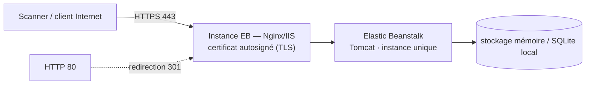

# Hélios Banque — Document d'architecture

> 🇫🇷 Version française ci-dessous — 🇬🇧 English version below (same content).

> **Environnement de test – données fictives.** Hélios Banque (Banque en ligne particuliers) est une application de laboratoire
> du Banking DAST Benchmark Lab. Toutes les données sont fictives ; aucune marque réelle n'est utilisée.

## 1. Vue d'ensemble

- **Finalité** : Tableau de bord, comptes, opérations, bénéficiaires, relevés, virement avec OTP.
- **Pile technique** : Java 21, Spring Boot, Spring Security, rendu serveur Thymeleaf.
- **Protocole principal** : Web classique + REST léger.
- **Hôte de laboratoire** : `https://helios.lab.exemple` (HTTPS, HTTP 80 redirigé en 443).
- **Thème de sécurité** : Référence Web : SQLi de recherche, IDOR relevés/virements, session mal durcie, 2FA contournable.

## 2. Architecture AWS (HTTPS, sans filtrage IP, moindre coût)

- **Elastic Beanstalk** en **instance unique** (`SingleInstance`), runtime **Tomcat**.
- **HTTPS obligatoire** terminé **sur l'instance** (Nginx ou IIS, **certificat autosigné** généré au déploiement, SAN = CNAME EB) ; redirection HTTP 80 → 443 systématique ; **aucun ALB ni ACM**.
- **Accès ouvert sans filtrage IP** : Security Group entrant `0.0.0.0/0` sur 443 (et 80), compensé par
  données fictives, arrêt hors campagne, rôle IAM minimal et port 22 fermé.
- **Ressources** : instance unique (Graviton t4g / t3 selon plateforme), **stockage en mémoire** (profil `standalone`), aucune base externe.
- **Moindre coût** : mono-AZ, pas d'auto-scaling, pas de NAT Gateway, environnement arrêté hors fenêtres de scan
  (`deploy/stop.sh APP-01` / `deploy/start.sh APP-01`), suppression complète en fin de projet (`deploy/delete.sh APP-01`).

## 3. Architecture logique et composants

- Frontend SSR Thymeleaf
- Contrôleurs Spring MVC
- Services métier (comptes, virements, bénéficiaires)
- Spring Security — authentification par formulaire et session
- Couche d'accès JPA/Hibernate
- Génération de relevés PDF

## 4. Flux réseau

1. Le client (ou le scanner) atteint **l'instance Elastic Beanstalk** en **HTTPS (443)** (Nginx/IIS, certificat autosigné) ; tout trafic **HTTP (80)** est redirigé en 443.
2. Le proxy de l'instance transmet à l'application **Elastic Beanstalk** (Tomcat) en HTTP local.
3. L'application utilise son **stockage en mémoire** (réamorcé par `POST /admin/reset` avant chaque run) ; aucune base externe.
4. Les en-têtes de sécurité (HSTS, CSP, cookies durcis, suppression de bannière) sont gérés par l'application
   et le reverse proxy — certains écarts volontaires constituent des vulnérabilités du corpus.

## 5. Modèle d'authentification

Authentification par formulaire, cookie de session JSESSIONID, OTP de second facteur simulé.

## 6. Modèle de données (entités principales)

- Utilisateur (rôle CLIENT/ADVISOR/ADMIN)
- Compte (ACC-xxxx)
- Opération
- Bénéficiaire
- Virement (état PENDING_OTP/EXECUTED)
- Relevé

## 7. Surface de sécurité

L'application est **sécurisée par défaut** ; les **22 vulnérabilités** du référentiel sont des **écarts localisés**
(voir `VULNERABILITY_GUIDE.md` et `ground-truth.yaml`, non exposés par HTTP). Des **negative controls**
fournissent des routes comparables correctement sécurisées. Couche d'accent : **Référence Web **.

## 8. Déploiement et exploitation

- Déploiement : `deploy/deploy.sh APP-01` (chaîne commune : precheck, build, bundle sans oracle, environnement EB Single Instance, HTTPS autosigné, validation) ; paramètres dans `deploy/apps/APP-01.env`.
- Démarrage / arrêt hors campagne : `deploy/start.sh APP-01` / `deploy/stop.sh APP-01` (ou `--all`).
- Suppression complète : `deploy/delete.sh APP-01`.
- Variables d'environnement injectées au déploiement ; aucun secret dans le dépôt.

## 9. Rappels de laboratoire

- Bandeau permanent « Environnement de test – données fictives » sur toutes les pages.
- Réinitialisation de l'état de démonstration : `POST /admin/reset`.
- `VULNERABILITY_GUIDE.md`, `negative-controls.yaml` et `ground-truth.yaml` ne sont **jamais exposés par HTTP**.

---

# English version

# Hélios Banque — Architecture document

> **Test environment – fictitious data.** Hélios Banque (retail online banking) is a laboratory application
> of the Banking DAST Benchmark Lab. All data is fictitious; no real brand is used.

## 1. Overview

- **Purpose**: Dashboard, accounts, operations, beneficiaries, statements, transfer with OTP.
- **Technical stack**: Java 21, Spring Boot, Spring Security, Thymeleaf server-side rendering.
- **Main protocol**: Classic web + lightweight REST.
- **Lab host**: `https://helios.lab.exemple` (HTTPS, HTTP 80 redirected to 443).
- **Security theme**: Web reference: search SQLi, statement/transfer IDOR, poorly hardened session, bypassable 2FA.

## 2. AWS architecture (HTTPS, no IP filtering, lowest cost)

- **Elastic Beanstalk** in **single instance** (`SingleInstance`), **Tomcat** runtime.
- **Mandatory HTTPS** terminated **on the instance** (Nginx or IIS, **self-signed certificate** generated at deployment, SAN = EB CNAME); systematic HTTP 80 → 443 redirection; **no ALB or ACM**.
- **Open access without IP filtering**: inbound Security Group `0.0.0.0/0` on 443 (and 80), offset by
  fictitious data, shutdown outside campaigns, minimal IAM role and closed port 22.
- **Resources**: single instance (Graviton t4g / t3 depending on platform), **in-memory storage** (`standalone` profile), no external database.
- **Lowest cost**: single-AZ, no auto-scaling, no NAT Gateway, environment stopped outside scan windows
  (`deploy/stop.sh APP-01` / `deploy/start.sh APP-01`), full deletion at the end of the project (`deploy/delete.sh APP-01`).

## 3. Logical architecture and components

- Thymeleaf SSR frontend
- Spring MVC controllers
- Business services (accounts, transfers, beneficiaries)
- Spring Security — form authentication and session
- JPA/Hibernate data access layer
- PDF statement generation

## 4. Network flow

1. The client (or the scanner) reaches **the Elastic Beanstalk instance** over **HTTPS (443)** (Nginx/IIS, self-signed certificate); all **HTTP (80)** traffic is redirected to 443.
2. The instance proxy forwards to the **Elastic Beanstalk** application (Tomcat) over local HTTP.
3. The application uses its **in-memory storage** (re-seeded by `POST /admin/reset` before each run); no external database.
4. The security headers (HSTS, CSP, hardened cookies, banner removal) are handled by the application
   and the reverse proxy — some intentional deviations constitute vulnerabilities of the corpus.

## 5. Authentication model

Form authentication, JSESSIONID session cookie, simulated second-factor OTP.

## 6. Data model (main entities)

- User (role CLIENT/ADVISOR/ADMIN)
- Account (ACC-xxxx)
- Operation
- Beneficiary
- Transfer (state PENDING_OTP/EXECUTED)
- Statement

## 7. Security surface

The application is **secure by default**; the **22 vulnerabilities** of the reference are **localized deviations**
(see `VULNERABILITY_GUIDE.md` and `ground-truth.yaml`, not exposed over HTTP). **Negative controls**
provide comparable, correctly secured routes. Emphasis layer: **Web reference**.

## 8. Deployment and operations

- Deployment: `deploy/deploy.sh APP-01` (shared chain: precheck, build, bundle without oracle, EB Single Instance environment, self-signed HTTPS, validation); parameters in `deploy/apps/APP-01.env`.
- Startup / shutdown outside campaigns: `deploy/start.sh APP-01` / `deploy/stop.sh APP-01` (or `--all`).
- Full deletion: `deploy/delete.sh APP-01`.
- Environment variables injected at deployment; no secret in the repository.

## 9. Laboratory reminders

- Permanent "Environnement de test – données fictives" banner on all pages.
- Reset of the demo state: `POST /admin/reset`.
- `VULNERABILITY_GUIDE.md`, `negative-controls.yaml` and `ground-truth.yaml` are **never exposed over HTTP**.
