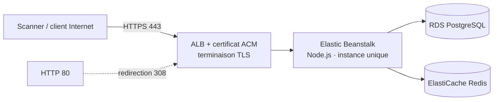

> 🇫🇷 Version française ci-dessous — 🇬🇧 English version below (same content).

# Agréga Open — Document d'architecture

> **Environnement de test – données fictives.** Agréga Open (API d'agrégation de comptes (Open Banking)) est une application de laboratoire
> du Banking DAST Benchmark Lab. Toutes les données sont fictives ; aucune marque réelle n'est utilisée.

## 1. Vue d'ensemble

- **Finalité** : Flux d'autorisation OAuth2, obtention de token, consentements, endpoints comptes/paiements/exports.
- **Pile technique** : Node.js 20, NestJS, TypeScript.
- **Protocole principal** : REST (OpenAPI 3) — API pure.
- **Hôte de laboratoire** : `https://agrega.lab.exemple` (HTTPS, HTTP 80 redirigé en 443).
- **Thème de sécurité** : API : BOLA inter-TPP, OAuth2/JWT (scopes, audience, alg), inventaire d'API, SSRF webhook.

## 2. Architecture AWS (HTTPS, sans filtrage IP, moindre coût)

- **Elastic Beanstalk** en **instance unique** (`SingleInstance`), runtime **Node.js**.
- **HTTPS** via **ALB mutualisé + certificat ACM** ; redirection HTTP 80 → 443.
- **Accès ouvert sans filtrage IP** : Security Group entrant `0.0.0.0/0` sur 443 (et 80), compensé par
  données fictives, arrêt hors campagne, rôle IAM minimal et réseau sortant restreint.
- **Ressources** : instance t3.small, RDS PostgreSQL, ElastiCache Redis.
- **Moindre coût** : mono-AZ, pas d'auto-scaling, pas de NAT Gateway, environnement arrêté hors fenêtres de scan
  (`deploy/30-start.sh` / `31-stop.sh`), suppression complète en fin de projet (`deploy/90-destroy.sh`).

## 3. Architecture logique et composants

- Passerelle API NestJS (REST, OpenAPI 3)
- Module OAuth2/OIDC adossé à l'IdP du laboratoire
- Guards JWT et contrôle de scope
- Services comptes / paiements / exports
- Cache Redis (jetons, consentements)
- Appel de webhooks de consentement

## 4. Flux réseau

1. Le client (ou le scanner) atteint l'**ALB** en **HTTPS (443)** ; tout trafic **HTTP (80)** est redirigé en 443.
2. L'ALB transmet à l'instance **Elastic Beanstalk** (Node.js).
3. L'application accède à **RDS PostgreSQL**, au cache **Redis**.
4. Les en-têtes de sécurité (HSTS, CSP, cookies durcis, suppression de bannière) sont gérés par l'application
   et le reverse proxy — certains écarts volontaires constituent des vulnérabilités du corpus.

## 5. Modèle d'authentification

OAuth2 / OIDC via l'IdP du laboratoire, jetons JWT porteurs (scopes, audience), clés d'API par TPP.

## 6. Modèle de données (entités principales)

- TPP (client OAuth : tpp-a, tpp-b)
- Utilisateur sous-jacent
- Consentement (scopes)
- Compte
- Paiement
- Export agrégé
- Jeton / scope OAuth2

## 7. Surface de sécurité

L'application est **sécurisée par défaut** ; les **22 vulnérabilités** du référentiel sont des **écarts localisés**
(voir `VULNERABILITY_GUIDE.md` et `ground-truth.yaml`, non exposés par HTTP). Des **negative controls**
fournissent des routes comparables correctement sécurisées. Couche d'accent : **API **.

## 8. Déploiement et exploitation

- Déploiement : `deploy/20-deploy-eb.sh` (environnement EB + listener HTTPS 443 + redirection 80).
- Démarrage / arrêt hors campagne : `deploy/30-start.sh` / `deploy/31-stop.sh`.
- Suppression complète : `deploy/90-destroy.sh`.
- Variables d'environnement injectées au déploiement ; aucun secret dans le dépôt.

## 9. Rappels de laboratoire

- Bandeau permanent « Environnement de test – données fictives » sur toutes les pages.
- Réinitialisation de l'état de démonstration : `POST /admin/reset`.
- `VULNERABILITY_GUIDE.md`, `negative-controls.yaml` et `ground-truth.yaml` ne sont **jamais exposés par HTTP**.

---

# English version

# Agréga Open — Architecture document

> **Test environment – fictitious data.** Agréga Open (account aggregation API (Open Banking)) is a laboratory
> application of the Banking DAST Benchmark Lab. All data is fictitious; no real brand is used.

## 1. Overview

- **Purpose**: OAuth2 authorization flow, token retrieval, consents, accounts/payments/exports endpoints.
- **Technical stack**: Node.js 20, NestJS, TypeScript.
- **Main protocol**: REST (OpenAPI 3) — pure API.
- **Lab host**: `https://agrega.lab.exemple` (HTTPS, HTTP 80 redirected to 443).
- **Security theme**: API: inter-TPP BOLA, OAuth2/JWT (scopes, audience, alg), API inventory, webhook SSRF.

## 2. AWS architecture (HTTPS, no IP filtering, lowest cost)

- **Elastic Beanstalk** as a **single instance** (`SingleInstance`), **Node.js** runtime.
- **HTTPS** via **shared ALB + ACM certificate**; HTTP 80 → 443 redirection.
- **Open access without IP filtering**: inbound Security Group `0.0.0.0/0` on 443 (and 80), offset by
  fictitious data, shutdown outside campaigns, minimal IAM role and restricted outbound network.
- **Resources**: t3.small instance, RDS PostgreSQL, ElastiCache Redis.
- **Lowest cost**: single-AZ, no auto-scaling, no NAT Gateway, environment stopped outside scan windows
  (`deploy/30-start.sh` / `31-stop.sh`), full teardown at project end (`deploy/90-destroy.sh`).

## 3. Logical architecture and components

- NestJS API gateway (REST, OpenAPI 3)
- OAuth2/OIDC module backed by the lab IdP
- JWT guards and scope control
- Accounts / payments / exports services
- Redis cache (tokens, consents)
- Consent webhook invocation

## 4. Network flow

1. The client (or scanner) reaches the **ALB** over **HTTPS (443)**; all **HTTP (80)** traffic is redirected to 443.
2. The ALB forwards to the **Elastic Beanstalk** instance (Node.js).
3. The application accesses **RDS PostgreSQL** and the **Redis** cache.
4. Security headers (HSTS, CSP, hardened cookies, banner removal) are handled by the application
   and the reverse proxy — some intentional deviations constitute vulnerabilities of the corpus.

## 5. Authentication model

OAuth2 / OIDC via the lab IdP, JWT bearer tokens (scopes, audience), per-TPP API keys.

## 6. Data model (main entities)

- TPP (OAuth client: tpp-a, tpp-b)
- Underlying user
- Consent (scopes)
- Account
- Payment
- Aggregated export
- OAuth2 token / scope

## 7. Security surface

The application is **secure by default**; the **22 vulnerabilities** of the reference set are **localized deviations**
(see `VULNERABILITY_GUIDE.md` and `ground-truth.yaml`, not exposed over HTTP). **Negative controls**
provide comparable, correctly secured routes. Accent layer: **API **.

## 8. Deployment and operations

- Deployment: `deploy/20-deploy-eb.sh` (EB environment + HTTPS 443 listener + 80 redirection).
- Startup / shutdown outside campaigns: `deploy/30-start.sh` / `deploy/31-stop.sh`.
- Full teardown: `deploy/90-destroy.sh`.
- Environment variables injected at deployment; no secret in the repository.

## 9. Laboratory reminders

- Permanent "Test environment – fictitious data" banner on all pages.
- Reset of the demo state: `POST /admin/reset`.
- `VULNERABILITY_GUIDE.md`, `negative-controls.yaml` and `ground-truth.yaml` are **never exposed over HTTP**.
