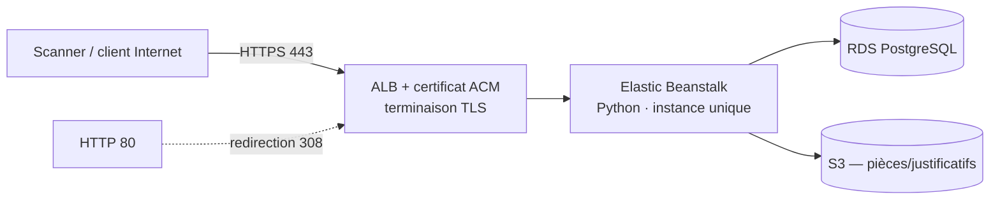

> 🇫🇷 Version française ci-dessous — 🇬🇧 English version below (same content).

# CréditFlux — Document d'architecture

> **Environnement de test – données fictives.** CréditFlux (Portail de crédit) est une application de laboratoire
> du Banking DAST Benchmark Lab. Toutes les données sont fictives ; aucune marque réelle n'est utilisée.

## 1. Vue d'ensemble

- **Finalité** : Demande de prêt, dépôt de justificatifs, import de documents, suivi de dossier.
- **Pile technique** : Python 3.12, Django, rendu serveur.
- **Protocole principal** : Web + multipart (upload de justificatifs).
- **Hôte de laboratoire** : `https://creditflux.lab.exemple` (HTTPS, HTTP 80 redirigé en 443).
- **Thème de sécurité** : Upload et traitement de fichiers : upload non restreint, XXE, SSRF de pièce, désérialisation.

## 2. Architecture AWS (HTTPS, sans filtrage IP, moindre coût)

- **Elastic Beanstalk** en **instance unique** (`SingleInstance`), runtime **Python**.
- **HTTPS** via **ALB mutualisé + certificat ACM** ; redirection HTTP 80 → 443.
- **Accès ouvert sans filtrage IP** : Security Group entrant `0.0.0.0/0` sur 443 (et 80), compensé par
  données fictives, arrêt hors campagne, rôle IAM minimal et réseau sortant restreint.
- **Ressources** : instance t3.small, RDS PostgreSQL, S3.
- **Moindre coût** : mono-AZ, pas d'auto-scaling, pas de NAT Gateway, environnement arrêté hors fenêtres de scan
  (`deploy/30-start.sh` / `31-stop.sh`), suppression complète en fin de projet (`deploy/90-destroy.sh`).

## 3. Architecture logique et composants

- Frontend SSR Django
- Vues et services Django
- Authentification par formulaire, session, jeton anti-CSRF
- Traitement d'upload multipart et d'import de documents
- Récupération de pièces distantes
- Stockage des justificatifs sur S3

## 4. Flux réseau

1. Le client (ou le scanner) atteint l'**ALB** en **HTTPS (443)** ; tout trafic **HTTP (80)** est redirigé en 443.
2. L'ALB transmet à l'instance **Elastic Beanstalk** (Python).
3. L'application accède à **RDS PostgreSQL** et au stockage **S3**.
4. Les en-têtes de sécurité (HSTS, CSP, cookies durcis, suppression de bannière) sont gérés par l'application
   et le reverse proxy — certains écarts volontaires constituent des vulnérabilités du corpus.

## 5. Modèle d'authentification

Authentification par formulaire, session, jeton anti-CSRF.

## 6. Modèle de données (entités principales)

- Emprunteur
- Analyste crédit
- Demande de prêt (état, montant)
- Justificatif (fichier)
- Commentaire d'analyse

## 7. Surface de sécurité

L'application est **sécurisée par défaut** ; les **23 vulnérabilités** du référentiel sont des **écarts localisés**
(voir `VULNERABILITY_GUIDE.md` et `ground-truth.yaml`, non exposés par HTTP). Des **negative controls**
fournissent des routes comparables correctement sécurisées. Couche d'accent : **Upload et traitement de fichiers **.

## 8. Déploiement et exploitation

- Déploiement : `deploy/20-deploy-eb.sh` (environnement EB + listener HTTPS 443 + redirection 80).
- Démarrage / arrêt hors campagne : `deploy/30-start.sh` / `deploy/31-stop.sh`.
- Suppression complète : `deploy/90-destroy.sh`.
- Variables d'environnement injectées au déploiement ; aucun secret dans le dépôt.

## 9. Rappels de laboratoire

- Bandeau permanent « Environnement de test – données fictives » sur toutes les pages.
- Réinitialisation de l'état de démonstration : `POST /admin/reset`.
- `VULNERABILITY_GUIDE.md`, `negative-controls.yaml` et `ground-truth.yaml` ne sont **jamais exposés par HTTP**.

---

# English version

# CréditFlux — Architecture document

> **Test environment – fictitious data.** CréditFlux (Credit portal) is a lab application
> of the Banking DAST Benchmark Lab. All data is fictitious; no real brand is used.

## 1. Overview

- **Purpose**: Loan application, submission of supporting documents, document import, application tracking.
- **Technology stack**: Python 3.12, Django, server-side rendering.
- **Main protocol**: Web + multipart (upload of supporting documents).
- **Lab host**: `https://creditflux.lab.exemple` (HTTPS, HTTP 80 redirected to 443).
- **Security theme**: Upload and file handling: unrestricted upload, XXE, attachment SSRF, deserialization.

## 2. AWS architecture (HTTPS, no IP filtering, lowest cost)

- **Elastic Beanstalk** as a **single instance** (`SingleInstance`), **Python** runtime.
- **HTTPS** via a **shared ALB + ACM certificate**; HTTP 80 → 443 redirection.
- **Open access with no IP filtering**: inbound Security Group `0.0.0.0/0` on 443 (and 80), offset by
  fictitious data, shutdown outside campaigns, minimal IAM role and restricted outbound network.
- **Resources**: t3.small instance, RDS PostgreSQL, S3.
- **Lowest cost**: single-AZ, no auto-scaling, no NAT Gateway, environment stopped outside scan windows
  (`deploy/30-start.sh` / `31-stop.sh`), full teardown at the end of the project (`deploy/90-destroy.sh`).

## 3. Logical architecture and components

- Django SSR frontend
- Django views and services
- Form-based authentication, session, anti-CSRF token
- Multipart upload and document import handling
- Remote attachment fetching
- Storage of supporting documents on S3

## 4. Network flow

1. The client (or the scanner) reaches the **ALB** over **HTTPS (443)**; all **HTTP (80)** traffic is redirected to 443.
2. The ALB forwards to the **Elastic Beanstalk** instance (Python).
3. The application accesses **RDS PostgreSQL** and the **S3** storage.
4. Security headers (HSTS, CSP, hardened cookies, banner removal) are managed by the application
   and the reverse proxy — some intentional deviations constitute corpus vulnerabilities.

## 5. Authentication model

Form-based authentication, session, anti-CSRF token.

## 6. Data model (main entities)

- Borrower
- Credit analyst
- Loan application (state, amount)
- Supporting document (file)
- Analysis comment

## 7. Security surface

The application is **secure by default**; the **23 vulnerabilities** of the reference set are **localized deviations**
(see `VULNERABILITY_GUIDE.md` and `ground-truth.yaml`, not exposed over HTTP). **Negative controls**
provide comparable, correctly secured routes. Focus layer: **Upload and file handling **.

## 8. Deployment and operations

- Deployment: `deploy/20-deploy-eb.sh` (EB environment + HTTPS 443 listener + 80 redirection).
- Start / stop outside campaigns: `deploy/30-start.sh` / `deploy/31-stop.sh`.
- Full teardown: `deploy/90-destroy.sh`.
- Environment variables injected at deployment; no secret in the repository.

## 9. Lab reminders

- Permanent "Test environment – fictitious data" banner on all pages.
- Reset of the demo state: `POST /admin/reset`.
- `VULNERABILITY_GUIDE.md`, `negative-controls.yaml` and `ground-truth.yaml` are **never exposed over HTTP**.
