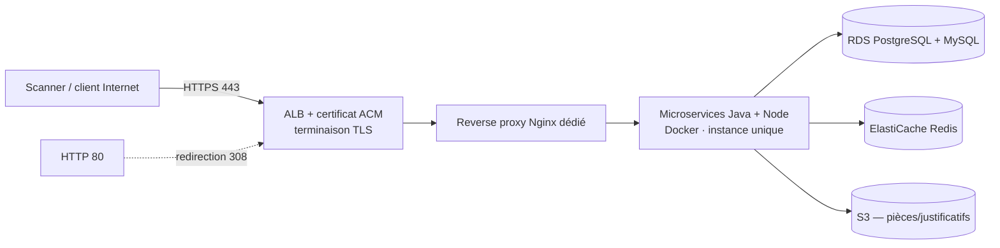

> 🇫🇷 Version française ci-dessous — 🇬🇧 English version below (same content).

# OnboardR — Document d'architecture

> **Environnement de test – données fictives.** OnboardR (Entrée en relation (KYC)) est une application de laboratoire
> du Banking DAST Benchmark Lab. Toutes les données sont fictives ; aucune marque réelle n'est utilisée.

## 1. Vue d'ensemble

- **Finalité** : Parcours d'ouverture de compte, dépôt de pièces, vérification KYC, suivi via la passerelle.
- **Pile technique** : Microservices Java (Spring Boot) + Node.js (NestJS) derrière un reverse proxy dédié.
- **Protocole principal** : REST + multipart (OpenAPI), reverse proxy Nginx dédié.
- **Hôte de laboratoire** : `https://onboardr.lab.exemple` (HTTPS, HTTP 80 redirigé en 443).
- **Thème de sécurité** : Architecture reverse proxy : bypass d'accès, confiance X-Forwarded-*, normalisation de chemin, SSRF inter-service, smuggling.

## 2. Architecture AWS (HTTPS, sans filtrage IP, moindre coût)

- **Elastic Beanstalk** en **instance unique** (`SingleInstance`), runtime **Docker**.
- **HTTPS** via **ALB mutualisé + certificat ACM** ; redirection HTTP 80 → 443.
- **Accès ouvert sans filtrage IP** : Security Group entrant `0.0.0.0/0` sur 443 (et 80), compensé par
  données fictives, arrêt hors campagne, rôle IAM minimal et réseau sortant restreint.
- **Ressources** : instance t3.small, RDS PostgreSQL + MySQL, ElastiCache Redis, S3.
- **Moindre coût** : mono-AZ, pas d'auto-scaling, pas de NAT Gateway, environnement arrêté hors fenêtres de scan
  (`deploy/30-start.sh` / `31-stop.sh`), suppression complète en fin de projet (`deploy/90-destroy.sh`).

## 3. Architecture logique et composants

- Reverse proxy Nginx dédié (routage, terminaison interne)
- Service d'onboarding Java (Spring Boot)
- Service documents Node.js (NestJS)
- Authentification par OTP simulé (client) et clé de service (interne)
- Stockage des pièces sur S3
- Bases PostgreSQL et MySQL

## 4. Flux réseau

1. Le client (ou le scanner) atteint l'**ALB** en **HTTPS (443)** ; tout trafic **HTTP (80)** est redirigé en 443.
2. L'ALB transmet à l'instance **Elastic Beanstalk** (Docker). Le trafic passe d'abord par le reverse proxy Nginx dédié qui route vers les microservices.
3. L'application accède à **RDS PostgreSQL + MySQL**, au cache **Redis** et au stockage **S3**.
4. Les en-têtes de sécurité (HSTS, CSP, cookies durcis, suppression de bannière) sont gérés par l'application
   et le reverse proxy — certains écarts volontaires constituent des vulnérabilités du corpus.

## 5. Modèle d'authentification

Code à usage unique simulé côté client ; clé de service pour les appels inter-services internes.

## 6. Modèle de données (entités principales)

- Prospect
- Agent de conformité
- Dossier KYC (état)
- Pièce d'identité
- Décision

## 7. Surface de sécurité

L'application est **sécurisée par défaut** ; les **21 vulnérabilités** du référentiel sont des **écarts localisés**
(voir `VULNERABILITY_GUIDE.md` et `ground-truth.yaml`, non exposés par HTTP). Des **negative controls**
fournissent des routes comparables correctement sécurisées. Couche d'accent : **Architecture reverse proxy **.

## 8. Déploiement et exploitation

- Déploiement : `deploy/20-deploy-eb.sh` (environnement EB + listener HTTPS 443 + redirection 80).
- Démarrage / arrêt hors campagne : `deploy/30-start.sh` / `deploy/31-stop.sh`.
- Suppression complète : `deploy/90-destroy.sh`.
- Variables d'environnement injectées au déploiement ; aucun secret dans le dépôt.

## 9. Rappels de laboratoire

- Bandeau permanent « Environnement de test – données fictives » sur toutes les pages.
- Réinitialisation de l'état de démonstration : `POST /admin/reset`.
- `VULNERABILITY_GUIDE.md`, `negative-controls.yaml` et `ground-truth.yaml` ne sont **jamais exposés par HTTP**.

---

# English version

# OnboardR — Architecture document

> **Test environment – fictitious data.** OnboardR (Client onboarding (KYC)) is a laboratory application
> of the Banking DAST Benchmark Lab. All data is fictitious; no real brand is used.

## 1. Overview

- **Purpose**: Account opening journey, document upload, KYC verification, tracking via the gateway.
- **Technical stack**: Java microservices (Spring Boot) + Node.js (NestJS) behind a dedicated reverse proxy.
- **Main protocol**: REST + multipart (OpenAPI), dedicated Nginx reverse proxy.
- **Laboratory host**: `https://onboardr.lab.exemple` (HTTPS, HTTP 80 redirected to 443).
- **Security theme**: Reverse proxy architecture: access bypass, X-Forwarded-* trust, path normalization, inter-service SSRF, smuggling.

## 2. AWS architecture (HTTPS, no IP filtering, lowest cost)

- **Elastic Beanstalk** in **single instance** (`SingleInstance`), **Docker** runtime.
- **HTTPS** via a **shared ALB + ACM certificate**; HTTP 80 → 443 redirect.
- **Open access with no IP filtering**: inbound Security Group `0.0.0.0/0` on 443 (and 80), offset by
  fictitious data, shutdown outside campaigns, minimal IAM role and restricted outbound network.
- **Resources**: t3.small instance, RDS PostgreSQL + MySQL, ElastiCache Redis, S3.
- **Lowest cost**: single-AZ, no auto-scaling, no NAT Gateway, environment stopped outside scan windows
  (`deploy/30-start.sh` / `31-stop.sh`), full teardown at project end (`deploy/90-destroy.sh`).

## 3. Logical architecture and components

- Dedicated Nginx reverse proxy (routing, internal termination)
- Java onboarding service (Spring Boot)
- Node.js documents service (NestJS)
- Authentication via simulated OTP (client) and service key (internal)
- Document storage on S3
- PostgreSQL and MySQL databases

## 4. Network flow

1. The client (or the scanner) reaches the **ALB** over **HTTPS (443)**; all **HTTP (80)** traffic is redirected to 443.
2. The ALB forwards to the **Elastic Beanstalk** instance (Docker). Traffic first passes through the dedicated Nginx reverse proxy, which routes to the microservices.
3. The application accesses **RDS PostgreSQL + MySQL**, the **Redis** cache and **S3** storage.
4. Security headers (HSTS, CSP, hardened cookies, banner suppression) are handled by the application
   and the reverse proxy — some intentional deviations constitute corpus vulnerabilities.

## 5. Authentication model

Simulated one-time code on the client side; service key for internal inter-service calls.

## 6. Data model (main entities)

- Prospect
- Compliance officer
- KYC dossier (state)
- ID document
- Decision

## 7. Security surface

The application is **secure by default**; the **21 vulnerabilities** of the reference set are **localized deviations**
(see `VULNERABILITY_GUIDE.md` and `ground-truth.yaml`, not exposed over HTTP). **Negative controls**
provide comparable, correctly secured routes. Emphasis layer: **Reverse proxy architecture**.

## 8. Deployment and operations

- Deployment: `deploy/20-deploy-eb.sh` (EB environment + HTTPS 443 listener + 80 redirect).
- Startup / shutdown outside campaigns: `deploy/30-start.sh` / `deploy/31-stop.sh`.
- Full teardown: `deploy/90-destroy.sh`.
- Environment variables injected at deployment; no secret in the repository.

## 9. Laboratory reminders

- Permanent "Test environment – fictitious data" banner on every page.
- Reset the demo state: `POST /admin/reset`.
- `VULNERABILITY_GUIDE.md`, `negative-controls.yaml` and `ground-truth.yaml` are **never exposed over HTTP**.
